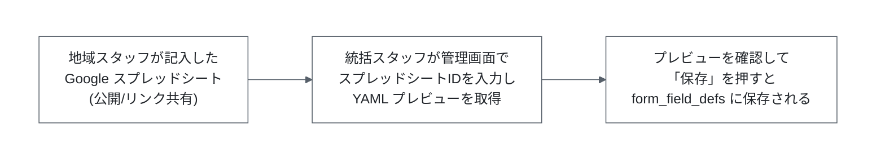

# Google スプレッドシート連携(フォーム定義・レギュレーションのインポート)

このドキュメントは、地域スタッフが Google スプレッドシートに入力した内容を、統括スタッフが管理画面から取り込む機能についてまとめたものです。取り込めるのは次の2つで、同じスプレッドシートの別々のシートに書きます。

- **追加の質問項目(フォーム定義)**: 先頭のシート。大会編集画面で YAML としてプレビューして保存する(Task 2-3/2-4)。
- **レギュレーションと優先エントリー期間**: 「レギュレーション」という名前のシート。レギュレーション管理画面のフォームに読み込み、内容を確認して保存する。
実装済みのコード(`apps/backend/src/lib/sheet-to-form-definition.ts` ほか)を基に、仕組み・必要な設定・使い方を記載します。

## 1. 全体像



- スプレッドシートの読み取りは **API キー認証**で行う(サービスアカウントではない)。そのため取り込み対象のスプレッドシートは「リンクを知っている全員が閲覧可」に共有しておく必要がある。
- 「プレビュー」と「保存」は別 API に分かれた 2 段階のフロー。プレビュー段階では DB に何も書き込まれず、YAML 文字列がブラウザに返るだけ。保存段階で初めて `form_field_defs` テーブルに永続化される。
- スプレッドシート取り込みは大会(tournament)本体の CRUD とは別レイヤの機能で、大会編集画面(`/admin/tournaments/[id]/edit`)に UI として組み込まれている。取り込みには大会の種別が必要なため、大会作成画面(`/admin/tournaments/new`)には置かれていない。
- レギュレーションと優先エントリー期間も地域スタッフが決めるもので、同じスプレッドシートの「レギュレーション」シートから取り込む。フォーム定義とは画面も API も保存先のテーブルも別(6章・7章)。どちらの取り込みも、読み込んだだけでは DB に書き込まれない。

> **設計書との差異**: `tasks/task-2-3.md` の初期設計では「サービスアカウント認証」を想定していたが、実装では API キー認証に変更されている(理由は後述)。ドキュメントや今後の設計変更時はこの点に注意すること。

## 2. 関連ファイル

| ファイル | 役割 |
| --- | --- |
| `apps/backend/src/lib/sheet-to-form-definition.ts` | `fetchSheetRows()`(Sheets API v4 呼び出し)・`sheetRowsToYaml()`(行データ→YAML変換) |
| `apps/backend/src/lib/sheet-to-regulations.ts` | `fetchRegulationSheetValues()`(「レギュレーション」シートの取得)・`sheetValuesToRegulations()`(行データ→レギュレーション配列) |
| `apps/backend/src/routes/sheet-import.ts` | `POST /api/sheet-import/preview`(フォーム定義)・`POST /api/sheet-import/regulations/preview`(レギュレーション)・`POST /api/sheet-import/tournaments`(大会一覧からの一括登録、#168)。統括スタッフ限定 |
| `apps/backend/src/lib/tournament-bulk-import.ts` | 大会一覧の読み取り(`parseTournamentIndex()`)・締切の既定値(`defaultEntryClosesAt()`)・行ごとの登録(`importTournaments()`) |
| `apps/frontend/src/routes/admin/tournaments/import/` | 一括登録の画面 |
| `apps/backend/src/routes/form-definitions.ts` | `PUT /api/form-definitions/:tournamentId`。プレビュー済み YAML をパース・検証して保存処理に渡す(Task 2-2)。統括スタッフ限定 |
| `apps/backend/src/lib/form-definitions.ts` | `syncFormFieldDefs()`。大会種別の照合と `form_field_defs` の置き換え(`sync_form_field_defs` RPC) |
| `apps/backend/src/types/env.ts` | `Bindings.GOOGLE_SHEETS_API_KEY` を定義 |
| `packages/shared/src/schemas/form-definition.ts` | YAML のスキーマ(`FormFieldDefYamlSchema` 等)。バックエンド/フロントエンド共通 |
| `apps/frontend/src/lib/components/FormDefinitionEditor.svelte` | フォーム定義の YAML エディタ。保存済みの定義から始め、YAML の直接編集と、スプレッドシートID入力→読み込み(エディタの中身を置き換え)のどちらでも直せる。保存は「保存」を押したときだけ。大会スラッグは入力させず、props の `tournamentType` を使う(#164) |
| `apps/frontend/src/lib/components/TournamentEditor.svelte` | 大会編集画面の本体。大会フォームの下に `FormDefinitionEditor` を置く |
| `apps/frontend/src/routes/admin/tournaments/new/+page.server.ts` | 大会新規作成画面の action。作成成功後は大会編集画面(`FormDefinitionEditor` 表示)へリダイレクトする |
| `apps/frontend/src/routes/admin/tournaments/[id]/edit/+page.server.ts` | 大会編集画面の `load`。保存済みのフォーム定義(`GET /api/form-definitions/:tournamentId`)を `formFieldDefsToYaml()` で YAML に書き戻してエディタに渡す |
| `apps/frontend/src/routes/admin/tournaments/[id]/edit/+page.svelte` | 大会編集画面。`TournamentEditor` 経由で常時 `FormDefinitionEditor` を表示 |
| `apps/frontend/src/routes/admin/tournaments/[id]/regulations/+page.server.ts` | レギュレーション管理画面。`import` action がシートを読んでフォームの行を組み立て、`save` action が保存する |
| `packages/shared/src/schemas/regulation.ts` | `REGULATION_SHEET_NAME`(シート名)・`RegulationSheetImportRequestSchema`・保存時の `RegulationSyncInputSchema` |

Sheets API 専用の SDK(`googleapis` 等)は使わず、`fetch` で REST エンドポイントを直接呼び出している。YAML の変換には `yaml` パッケージ(`stringify`/`parse`)を使用。

## 3. 認証方式(API キー)

`fetchSheetRows()` のコメントに明記されている通り:

> サービスアカウントではなく API キーで認証するため、対象のスプレッドシートは公開/リンク共有にしておく必要がある。

- 使用するのは Google Sheets API v4 の `spreadsheets.values.get` エンドポイント。
- 呼び出し例(フォーム定義): `https://sheets.googleapis.com/v4/spreadsheets/{spreadsheetId}/values/A2%3AE?key={apiKey}`
- 呼び出し例(レギュレーション): 範囲は `'レギュレーション'!A2:C`(URL エンコードして送る)。`valueRenderOption=UNFORMATTED_VALUE` と `dateTimeRenderOption=SERIAL_NUMBER` を付け、日時セルを表示形式に依存しないシリアル値で受け取る。
- API キーは Cloudflare Workers の Bindings 経由の環境変数 `GOOGLE_SHEETS_API_KEY`(`apps/backend/src/types/env.ts`)として渡す。

このためのトレードオフ:

- **メリット**: サービスアカウントの JSON 鍵管理・スプレッドシートごとの個別共有設定が不要で、地域スタッフ側の運用負荷が低い。
- **デメリット**: 取り込み対象のスプレッドシートを「リンクを知っている全員が閲覧可」にする必要があり、URL(スプレッドシートID)が漏れると誰でも内容を閲覧できてしまう。個人情報や非公開情報を含むシートをこの用途に流用しないよう、地域スタッフへの周知が必要。

## 4. Google Cloud 側の設定

1. **Google Sheets API の有効化**: 対象の Google Cloud プロジェクトで [Google Sheets API](https://console.cloud.google.com/apis/library/sheets.googleapis.com) を有効化する。
2. **API キーの発行**: `APIs & Services > Credentials` から API キーを新規作成する。
   - キーの制限として「API restrictions」で Google Sheets API のみに絞ることを推奨(他の Google API への悪用を防ぐため)。
   - IP アドレス制限は Cloudflare Workers の送信元 IP が固定でないため実質的に使えない。リファラー制限もサーバーサイドからの呼び出しのため効果がない点に注意。
3. **発行したキーを Cloudflare Workers のシークレットとして登録**(手順は後述)。

## 5. フォーム定義シート(先頭のシート)のフォーマット規約

- 取り込み範囲は固定で `A2:E`(1行目はヘッダー行として扱われ、読み飛ばされる)。シート名を指定していないため、読まれるのは**先頭(左端)のシート**。フォーム定義のシートは先頭に置くこと。
- データ行は2行目から**空行を挟まず**に詰めて書く。途中に空行があると、その行の `type` が空として扱われ `Unknown field type: undefined` で取り込みに失敗する(末尾の空行は Sheets API が返さないので問題ない)。
- 列は左から順に **`key, label, type, required, options`** の5列固定。

| 列 | 内容 | 例 |
| --- | --- | --- |
| A: key | フィールド識別子。`/^[a-z][a-z0-9_]*$/` に一致する必要がある(小文字英数字とアンダースコアのみ、先頭は英字)。前後の空白は除去されないので、空白が混じると不正な形式として弾かれる。シート内で重複不可(重複はプレビューでは検出されず、保存時に 400 になる) | `tshirt_size` |
| B: label | 表示ラベル。空欄は検証で弾かれず、空のラベルのまま取り込まれてしまうので必ず記入する。`<a href="https://...">文字</a>` と書くとその部分がリンクになる(`http(s)` の URL のみ。詳細は [`form-generation.md`](./form-generation.md)) | `T シャツのサイズ` |
| C: type | `チェックボックス` / `ラジオボタン` / `自由記述`(複数行)/ `自由記述（一行）`(括弧は全角)のいずれか | `ラジオボタン` |
| D: required | 文字列 `必須` の場合のみ必須。それ以外(`任意`・空欄等)はすべて任意扱い | `必須` |
| E: options | カンマ区切りの選択肢(各要素は trim され、空要素は除去、重複は不可)。各選択肢にも B 列と同じ形でリンクを書ける(URL にカンマを含めないこと)。`ラジオボタン` は最低1件必須、`チェックボックス`/`自由記述`/`自由記述（一行）` は省略可 | `S, M, L, XL` |

C列(type)・D列(required)は Google スプレッドシート側のデータの入力規則(プルダウン)で上記の値のみ選択可能にする運用を想定している(配布済みのテンプレートのプルダウンには `自由記述（一行）` を追加すること)(地域スタッフが自由入力するとタイプミスで取り込みに失敗するため)。

シート例(1行目はヘッダー、2行目以降がデータ):

| key | label | type | required | options |
| --- | --- | --- | --- | --- |
| tshirt_size | T シャツのサイズ | ラジオボタン | 必須 | S, M, L, XL |
| has_allergy | アレルギーの有無 | チェックボックス | 任意 | |
| affiliation | 所属 | 自由記述（一行） | 任意 | |
| notes | 備考 | 自由記述 | 任意 | |
| agree_to_rules | <a href="https://example.com/rules">規約</a>に同意する | チェックボックス | 必須 | |

地域スタッフに配布するテンプレートシートは、この列構成に合わせて作成すること。

### key について

`key`(DB上のフィールド識別子)は地域スタッフがスプレッドシートの A 列に直接入力する。行の並び順や日本語の `label` から自動生成する方式は採用していない(`label` の漢字の読みが一意に定まらず、機械的に意味のある英数字 key を生成する精度に限界があるため)。

エントリーは `custom_field_values` を `key` で紐付けて永続化しているため、**一度保存したフォーム定義の `key` は変更しない**こと。既存の `key` を再利用しつつ行を並べ替えたり、フィールドを追加する場合は新しい `key` を末尾の行に追記したりする分には問題ない。誤って `key` を変更したまま再インポート・保存すると、既存の回答データが別のフィールドに紐付いたように見えてしまう。

## 6. レギュレーションシートのフォーマット規約

レギュレーション(参加条件)と優先エントリー期間も地域スタッフが決める。フォーム定義と同じスプレッドシートに、**「レギュレーション」という名前のシート**を作って記入する。

- シート名は `レギュレーション` と完全に一致させる(`REGULATION_SHEET_NAME`)。シートの位置は問わないが、先頭はフォーム定義のシートなので2枚目以降に置く。
- 取り込み範囲は `A2:C`(1行目はヘッダー行として読み飛ばされる)。
- 行の並び順がそのままエントリーフォームでの表示順になる。
- A〜C列がすべて空の行は読み飛ばされるので、空行を挟んでもよい。

| 列 | 内容 | 例 |
| --- | --- | --- |
| A: レギュレーション名 | エントリーフォームに表示する文言。必須。前後の空白は除去される。200文字以内。シート内で重複不可 | `開催地域に在住・在学・在勤の方` |
| B: 優先期間の開始 | 優先エントリー期間を設ける場合のみ記入。**日本時間**として読まれる | `2026-08-01 10:00` |
| C: 優先期間の終了 | B列を記入した場合は必須。開始より後の日時 | `2026-08-08 10:00` |

シート例:

| レギュレーション名 | 優先期間の開始 | 優先期間の終了 |
| --- | --- | --- |
| 開催地域に在住・在学・在勤の方 | 2026-08-01 10:00 | 2026-08-08 10:00 |
| 上記以外の方 | | |

### 優先期間の書き方

- B列・C列は**両方記入するか、両方空欄にする**。片方だけ、または終了が開始以前だと取り込みに失敗する。
- 日時は次のどちらの形でも読める。
  - 日付/日時の書式のセル(スプレッドシートが日時として認識している値)。表示形式は問わない。
  - 文字列として入力した `2026-08-01 10:00` / `2026/8/1 10:00` / `2026-08-01 10:00:30`。日付だけ(`2026-08-01`)の場合はその日の 0:00 として読む。
- それ以外の書き方(`8月1日 10時` など)や、存在しない日付(`2026-02-30`)は読み取れずエラーになる。
- **スプレッドシートのタイムゾーン設定に関わらず、書かれた日時をそのまま日本時間として扱う**。
- いずれかのレギュレーションの優先期間中は、その優先対象のレギュレーションを1つ以上選んだ参加者だけがエントリーできる(判定は `isRegulationSelectionAllowed()`。詳細は [`database-schema.md`](./database-schema.md) の `regulations`)。

### 保存済みのレギュレーションとの対応付け

シートには行の ID が無いため、取り込み時は**レギュレーション名の完全一致**で保存済みの行と対応付ける。

- 名前が一致する行は「更新」になる(優先期間や並び順だけを変える場合はこれ)。既存エントリーの紐付けは保たれる。
- 保存済みに無い名前は「追加」になる。
- シートに無くなった保存済みの行は、フォームの末尾に「削除する」にチェックが付いた状態で残る。残したい場合はチェックを外す。
- **名前を書き換えると「旧名の削除 + 新名の追加」になる**。旧名のレギュレーションを選んだエントリーが既にある場合、保存は 409 で拒否される(エントリーで使用中のレギュレーションは削除できない)。エントリー受付後に文言を直したいときは、シートではなくレギュレーション管理画面で該当行の名前を直接書き換える。

## 7. 処理フロー(フォーム定義)

1. 統括スタッフが大会編集画面のフォーム定義エディタ(`FormDefinitionEditor.svelte`)で「スプレッドシートID」を入力し、「スプレッドシートから読み込む」を押す。大会スラッグは手入力させず、**エディタが編集中の大会の `type`(`saikyoi` / `shinjinou`)を親から props で受け取ってそのまま使う**。対象の種別はエディタ上部に表示される。
2. フロントエンドが `POST /api/sheet-import/preview` に `{spreadsheetId, tournamentSlug}`(`packages/shared` の `SheetImportRequestSchema`)を送信。`tournamentSlug` は `TournamentTypeSchema` の enum なので、`saikyoi` / `shinjinou` 以外は 400 で弾かれる。ルートは `requireGeneralStaff()` ミドルウェアで保護されており、統括スタッフ(`role: 'general'`)のみアクセス可能(未ログイン・セッション切れは 401、地域スタッフは 403)。この認証チェックはボディの検証より先に走る。
3. バックエンドの `fetchSheetRows(spreadsheetId, c.env.GOOGLE_SHEETS_API_KEY)` がシートの `A2:E` を取得。ネットワークエラーや Google からの非 2xx レスポンスは、HTTP ステータス(取得できた場合)を保持した `SheetFetchError` として throw される。
4. `sheetRowsToYaml(tournamentSlug, rows)` が各行を YAML 化する。
   - `key` はスプレッドシートの A 列に地域スタッフが入力した値をそのまま使う(5章参照)。
   - `type` は `TYPE_LABELS`(`チェックボックス`→`checkbox`、`ラジオボタン`→`radio`、`自由記述`→`textarea`、`自由記述（一行）`→`textfield`)で内部の enum に変換。未知の値の場合は `Unknown field type: {値}` を throw。
   - `required` は文字列 `'必須'` との一致で boolean 化(それ以外はすべて `false`)。
   - `options` はカンマ区切り文字列を trim・空要素除去した配列に変換。重複が残っている場合は `Duplicate option values: {値}` を throw。
   - 最後に `FormFieldDefYamlSchema.parse()` で行ごとに検証(例: `key` が不正な形式、`ラジオボタン` なのに `options` が空、など)。バリデーション失敗時は `ZodError` を throw。
   - **`key` の重複はここでは検出されない**(行単位の検証しかしていないため)。重複したままでもプレビューは成功し、保存時の `FormDefinitionYamlSchema` の検証で 400 になる。
5. 上記で例外が発生した場合のレスポンスは原因によって異なる:
   - `SheetFetchError` でネットワーク障害または Google 側の 5xx → **502**。`error` は固定文言「Google スプレッドシートへの接続に失敗しました」(元の例外はサーバーログにのみ出力)。
   - `SheetFetchError` で Google のレート制限(429)→ **503**。`error` は固定文言「Google スプレッドシートへのリクエストが制限されています。しばらくしてから再試行してください」。
   - `SheetFetchError` でそれ以外の非 2xx(400/403/404 など、スプレッドシートID誤り・非公開など)、または `sheetRowsToYaml` からの `ZodError`/`Error`(入力起因) → **400**。`error` は例外のメッセージそのまま(`Failed to fetch sheet: 403`、`Unknown field type: ...` など。`ZodError` の場合は issue 一覧の JSON 文字列)。
   - いずれの場合も `{error: string}` を返す。成功時は `{yaml}` を 200 で返す。
   - リクエストボディ自体が `SheetImportRequestSchema` に合わない場合の 400 だけは形が異なり、`@hono/zod-validator` 既定の `{success: false, error: ZodError}` になる。パネルはこの場合「入力内容を確認してください」と表示する。
6. プレビューされた YAML を確認し、「保存」を押すと `PUT /api/form-definitions/:tournamentId` に `{yaml: previewYaml}` を送信。
7. 保存 API 側で `parseFormDefinitionYaml()` により再度パース・検証する(`key` の重複はここで 400)。続いて `syncFormFieldDefs()`(`apps/backend/src/lib/form-definitions.ts`)が、**YAML の `tournamentSlug` が `:tournamentId` の大会の `type` と一致するかを照合**した上で(食い違えば 400。この時点では DB 未変更なので既存定義は消えない。大会が存在しなければ 404)、`toFormFieldDefRows()` で `form_field_defs` テーブルの行形式に変換し、`sync_form_field_defs` RPC で既存の定義を丸ごと置き換える。成功時は `{ok: true}` を返す。詳細は [`form-generation.md`](./form-generation.md#tournamentslug-による取り違え検証) を参照。

### 処理フロー(レギュレーション)

フォーム定義と違って YAML は経由しない。**レギュレーション管理画面のフォームそのものがプレビュー**になる。

1. 統括スタッフが `/admin/tournaments/[id]/regulations` の「スプレッドシートから読み込む」にスプレッドシートIDを入力して押す(`?/import` action)。
2. action が `POST /api/sheet-import/regulations/preview` に `{spreadsheetId}`(`RegulationSheetImportRequestSchema`)を送る。ルートは `requireGeneralStaff()` で保護されている。
3. バックエンドの `fetchRegulationSheetValues()` が「レギュレーション」シートの `A2:C` を取得し、`sheetValuesToRegulations()` が配列に変換する。
   - 空行を読み飛ばし、名前の空欄・重複、読み取れない日時を行番号付きのエラーにする。
   - 最後に `RegulationSyncInputSchema` で検証する(優先期間が片方だけ・逆順、1件も無い、など)。
   - 成功時は `{regulations: [{label, priorityStartsAt, priorityEndsAt}]}` を返す。DB には何も書き込まない。
4. action が保存済みのレギュレーションと名前で突き合わせ(6章「保存済みのレギュレーションとの対応付け」)、フォームの行として返す。画面には「まだ保存されていません」と表示される。
5. 統括スタッフが内容を確認し(必要ならその場で手直しして)「保存」を押すと、`?/save` action が `PUT /api/tournaments/:tournamentId/regulations` を呼ぶ。保存の経路は手入力の場合と同じ。

エラー時のステータス(400 / 502 / 503)の切り分けはフォーム定義のプレビューと共通。「レギュレーション」シートが無い場合、Google は 400 を返すので、`error` は「「レギュレーション」シートを読み取れません。シート名とスプレッドシートIDを確認してください」になる。

## 8. 環境変数・シークレットの登録

`docs/supabase-deployment.md` の手順に倣い、`GOOGLE_SHEETS_API_KEY` も他のシークレットと同様に登録する。

### ローカル開発

`apps/backend/.dev.vars`(gitignore 対象、リポジトリには存在しないため各自作成)に追記する。

```
GOOGLE_SHEETS_API_KEY=<発行したAPIキー>
```

### staging / production(Cloudflare Workers)

```bash
cd apps/backend

# staging
bunx wrangler secret put GOOGLE_SHEETS_API_KEY --env staging

# production
bunx wrangler secret put GOOGLE_SHEETS_API_KEY --env production
```

> 同じコマンドは `docs/supabase-deployment.md` 6.2 節のシークレット一覧にも含まれている。新規環境構築時は同節の手順どおりに登録すれば本キーも登録される。

キーは環境ごとに別のものを発行する(staging / production で共有しない)。登録前にキー単体で読めるかを確かめる手順と、staging でどの画面から取り込みを試せるかは [`staging-setup-walkthrough.md`](./staging-setup-walkthrough.md) の手順 8 を参照。

## 9. 使い方

このツールは独立した CLI スクリプトではなく、**HTTP API + Web UI** として実装されている。

### Web UI から使う(通常の運用)

1. `bunx wrangler dev`(`apps/backend`)と SvelteKit の dev server(`apps/frontend`)を起動。
2. 統括スタッフでログインし、`/admin/tournaments`(管理メニューの「大会」)から大会の「編集」を開く(`/admin/tournaments/{id}/edit`)。フォーム定義エディタは大会の種別を必要とするため、大会を作成した**後**の編集画面にのみ置かれている(`/admin/tournaments/new` には無い)。
3. 「フォーム定義」でスプレッドシートIDを入力し「スプレッドシートから読み込む」を押す(大会スラッグは編集中の大会から自動で決まる)。読み込んだ YAML がエディタの中身を置き換える(まだ保存はされない)。
4. YAML を確認し(必要ならその場で書き換え)、問題なければ「保存」を押す。シートを直した後の再読み込みも同じ手順で、保存済みの定義が置き換わる。シートを使わず YAML を直接書き換えて「保存」してもよい。
5. レギュレーションを取り込む場合は、同じ画面の「レギュレーションを管理」リンクから `/admin/tournaments/{id}/regulations` を開く。「スプレッドシートから読み込む」に同じスプレッドシートIDを入力して読み込み、フォームの内容を確認して「保存」を押す。

### 大会を一括登録する(#168)

大会一覧のスプレッドシートから、記載されたすべての大会を一度に登録できる。各行の入力シートから、フォーム定義とレギュレーションもまとめて取り込む。

1. 統括スタッフでログインし、管理メニューの「大会を一括登録」(`/admin/tournaments/import`)を開く。
2. 大会一覧のスプレッドシートの URL(または ID)を貼り付けて「一括登録する」を押す。**プレビューの段階は無く、押すとすぐに登録される。**
3. 結果に「登録した大会」と「登録できなかった大会(理由つき)」が並ぶ。登録できなかった大会は、理由を直して再実行するか、大会の画面から個別に登録する。再実行しても、登録済みの大会は上書きされるだけで重複はしない。

大会一覧(先頭のシート)の書式:

- 1 行目がヘッダー。列は**ヘッダー名で探す**ので順番は問わない。必要なのは `地域` / `種別` / `実施日` / `スプレッドシートID` の 4 列で、それ以外の列(表示用の日付・スプレッドシート名・URL など)は読まない。
- `地域` は地域の画面で登録した**地域名と完全に一致**させる。
- `種別` は `最強位` / `新人王` のどちらか。
- `実施日` は `2026/12/26（土）` のように**先頭が年/月/日**の形(`2026-12-26` も可)。エントリーの締切はこの前日の 23:59(日本時間)。新しく作る大会のエントリー開始は登録した時刻になる。`調整中` など日付でない値の行は登録されない。
- `スプレッドシートID` はその大会の入力シート(5 章・6 章の書式)。ID の代わりに URL を書いてもよい。大会一覧と同じく「リンクを知っている全員が閲覧可」にしておくこと。
- 同じ地域・種別の行が 2 つ以上あると、どちらが正しいか決められないので**どちらも登録しない**。

既に登録されている大会(同じ地域・種別)は**上書き**される。締切・フォーム定義・レギュレーションが置き換わり、**エントリー開始**・大会名・定員はそのまま残る(エラーの出た行を直して流し直しても、受付開始前の大会が即時受付開始になることはない)。レギュレーションは名前で既存のものと突き合わせるので、名前を変えなければエントリーとの紐付けは保たれる。エントリーで使われているレギュレーションの名前を変えた(シートから消した)場合、その大会は登録できなかった大会として報告され、何も変更されない。フォーム定義の誤りは「フォーム定義 3行目: A列(key)…」のように行番号付きで報告される。

一括登録は Cloudflare Workers の**有料プラン**が前提(1 行ごとに Google と Supabase へのサブリクエストが発生し、無料プランの上限 50 では約 24 行で足りなくなる。一斉メールの Queues のため、このプロジェクトは元々有料プランを前提にしている)。

### API を直接叩く場合

```bash
curl -X POST http://localhost:8787/api/sheet-import/preview \
  -H 'Content-Type: application/json' \
  -H 'Cookie: staff_session=<統括スタッフのJWT>' \
  -d '{"spreadsheetId": "<スプレッドシートID>", "tournamentSlug": "saikyoi"}'

# レギュレーション
curl -X POST http://localhost:8787/api/sheet-import/regulations/preview \
  -H 'Content-Type: application/json' \
  -H 'Cookie: staff_session=<統括スタッフのJWT>' \
  -d '{"spreadsheetId": "<スプレッドシートID>"}'

# 大会の一括登録(書き込む)
curl -X POST http://localhost:8787/api/sheet-import/tournaments \
  -H 'Content-Type: application/json' \
  -H 'Cookie: staff_session=<統括スタッフのJWT>' \
  -d '{"spreadsheetId": "<大会一覧のスプレッドシートID>"}'
```

## 10. 関連スキーマ(`packages/shared/src/schemas/`)

`form-definition.ts`:

- `FormFieldTypeSchema`: `z.enum(['checkbox', 'radio', 'textarea'])`
- `FormFieldDefYamlSchema`: `type` による discriminated union。`radio` のみ `options` が必須(最低1件)。
- `FormDefinitionYamlSchema`: `{tournamentSlug, fields[]}`。`tournamentSlug` は `TournamentTypeSchema`(`saikyoi` / `shinjinou`)。`fields` 内で `key` が重複していないことを `.refine()` でチェック。
- `parseFormDefinitionYaml(yamlText)`: YAML文字列をパース・検証。
- `FormDefinitionUploadSchema`: 保存 API のリクエストボディ(`{yaml: string}`)。
- `SheetImportRequestSchema`: プレビュー API のリクエストボディ(`{spreadsheetId: string, tournamentSlug: 'saikyoi' | 'shinjinou'}`)。
- `toFormFieldDefRows(definition, tournamentId)`: パース済み定義を `form_field_defs` テーブルの行形式に変換。

`regulation.ts`:

- `REGULATION_SHEET_NAME`: レギュレーションを書くシートの名前(`レギュレーション`)。バックエンドの取得範囲と管理画面の案内文の両方が参照する。
- `RegulationSheetImportRequestSchema`: レギュレーションのプレビュー API のリクエストボディ(`{spreadsheetId: string}`)。
- `RegulationSyncInputSchema`: 保存 API のリクエストボディ。プレビューの変換結果もこれで検証する。

フォーム定義のスキーマを直接 import するのはバックエンド(`routes/sheet-import.ts`、`routes/form-definitions.ts`、`lib/form-definitions.ts`、`lib/sheet-to-form-definition.ts`)。フロントエンドの `FormDefinitionEditor.svelte` はスキーマを直接 import せず、`hc<AppType>()` のクライアント経由でリクエスト/レスポンスの型を受け取る(`@regional-quiz/shared` から import しているのは `TournamentType` と `TOURNAMENT_TYPE_LABELS` のみ)。

## 11. トラブルシューティング

| 症状 | 想定原因 | 対処 |
| --- | --- | --- |
| プレビューで 400、`Failed to fetch sheet: 403` | スプレッドシートが非公開、または API キーの制限設定が誤っている | スプレッドシートの共有設定を「リンクを知っている全員が閲覧可」に変更。API キーの API restrictions を確認 |
| プレビューで 400、`Failed to fetch sheet: 400`/`404` | スプレッドシートIDが誤っている | URL 内の `/d/` と `/edit` の間の文字列を再確認 |
| プレビューで 502、「Google スプレッドシートへの接続に失敗しました」 | Google Sheets API へのネットワーク接続に失敗、または Google 側が 5xx を返した | 統括スタッフ側で復旧を待って再試行。継続する場合は Cloudflare Workers 側のログ・Google Cloud のステータスを確認 |
| プレビューで 503、「Google スプレッドシートへのリクエストが制限されています…」 | Google Sheets API のレート制限(429)にかかった | しばらく待ってから再試行 |
| プレビューで 400、`Unknown field type: ...` | `type` 列が `チェックボックス`/`ラジオボタン`/`自由記述`/`自由記述（一行）` のいずれでもない | プルダウン(データの入力規則)の選択肢から入力し直す。表記ゆれ(全角/半角スペース等)がないか確認 |
| プレビューで 400、`Unknown field type: undefined` | データ行の途中に空行がある、または `type` 列が空欄の行がある | 空行を削除して行を詰める。`type` 列をプルダウンから選択する |
| プレビューで 400、`Duplicate option values: ...` | `options` 列内の値が trim 後に重複している | カンマ区切りの選択肢から重複を削除 |
| プレビューで Zod バリデーションエラー(例: `key` が不正な形式、`ラジオボタン` なのに `options` が空) | シートの列内容がフォーマット規約(5章)に沿っていない | シートの列順・`key` の形式(`/^[a-z][a-z0-9_]*$/`)・`options` の記法(カンマ区切り)を修正 |
| プレビューは成功するが保存で 400、「フィールドキーが重複しています」 | シート内で同じ `key` が複数行に使われている(プレビューでは検出されない) | 重複している `key` を修正してプレビューからやり直す |
| 保存で 400、`YAML の tournamentSlug (...) が保存先の大会の種別 (...) と一致しません` | YAML の `tournamentSlug` が保存先の大会の種別と違う(API を直接叩いて別種別の YAML を送った場合など。パネル経由では編集中の大会の種別が自動で入る) | 保存先の大会の編集画面でプレビューからやり直す |
| レギュレーションの読み込みで「「レギュレーション」シートを読み取れません…」 | `レギュレーション` という名前のシートが無い(名前の表記ゆれ・前後の空白を含む)、またはスプレッドシートIDが誤っている | シート名を `レギュレーション` に直す。IDを再確認 |
| レギュレーションの読み込みで `N行目: 優先期間の開始(終了)を日時として読み取れません` | 日時の書き方が規約(6章)に沿っていない、または存在しない日付 | `2026-08-01 10:00` の形で書き直す |
| レギュレーションの読み込みで `N行目: 優先期間は開始と終了の両方を指定してください` / `…終了は開始より後にしてください` | 優先期間が片方だけ、または逆順 | B列・C列を両方記入するか両方空欄にする |
| レギュレーションの読み込みで `N行目: レギュレーション名が空です` / `…が重複しています` | A列が空のまま優先期間だけ書かれている、または同じ名前が2行ある | A列を記入する。重複を解消する |
| レギュレーションの保存で 409、「エントリーで使用中のため削除できないレギュレーションがあります」 | シートで名前を書き換えた、または行を消したレギュレーションを選んだエントリーが既にある | 該当行の「削除する」を外す。文言を直したい場合は管理画面で名前を直接書き換える |
| プレビュー/保存で 401 | 未ログイン、またはセッション切れ | 統括スタッフでログインし直す |
| 統括スタッフでログインしているのに 403 | `role: 'regional'` のスタッフでログインしている | `requireGeneralStaff()` は統括スタッフ(`role: 'general'`)専用。地域スタッフはこの機能を使えない仕様 |
