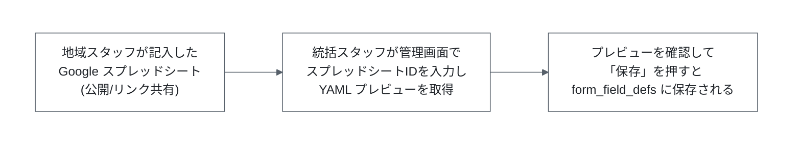

# Google スプレッドシート連携(フォーム定義インポート)

このドキュメントは、地域スタッフが Google スプレッドシートに入力したエントリーフォームのフィールド定義を、大会管理画面から YAML としてプレビュー・取り込む機能(Task 2-3/2-4)についてまとめたものです。実装済みのコード(`apps/backend/src/lib/sheet-to-form-definition.ts` ほか)を基に、仕組み・必要な設定・使い方を記載します。

## 1. 全体像



- スプレッドシートの読み取りは **API キー認証**で行う(サービスアカウントではない)。そのため取り込み対象のスプレッドシートは「リンクを知っている全員が閲覧可」に共有しておく必要がある。
- 「プレビュー」と「保存」は別 API に分かれた 2 段階のフロー。プレビュー段階では DB に何も書き込まれず、YAML 文字列がブラウザに返るだけ。保存段階で初めて `form_field_defs` テーブルに永続化される。
- スプレッドシート取り込みは大会(tournament)本体の CRUD とは別レイヤの機能で、大会編集画面(`/admin/tournaments/[id]/edit`)に UI として組み込まれている。取り込みには大会の種別が必要なため、大会作成画面(`/admin/tournaments/new`)には置かれていない。

> **設計書との差異**: `tasks/task-2-3.md` の初期設計では「サービスアカウント認証」を想定していたが、実装では API キー認証に変更されている(理由は後述)。ドキュメントや今後の設計変更時はこの点に注意すること。

## 2. 関連ファイル

| ファイル | 役割 |
| --- | --- |
| `apps/backend/src/lib/sheet-to-form-definition.ts` | `fetchSheetRows()`(Sheets API v4 呼び出し)・`sheetRowsToYaml()`(行データ→YAML変換) |
| `apps/backend/src/routes/sheet-import.ts` | `POST /api/sheet-import/preview` ルート。統括スタッフ限定 |
| `apps/backend/src/routes/form-definitions.ts` | `PUT /api/form-definitions/:tournamentId`。プレビュー済み YAML をパース・検証して保存処理に渡す(Task 2-2)。統括スタッフ限定 |
| `apps/backend/src/lib/form-definitions.ts` | `syncFormFieldDefs()`。大会種別の照合と `form_field_defs` の置き換え(`sync_form_field_defs` RPC) |
| `apps/backend/src/types/env.ts` | `Bindings.GOOGLE_SHEETS_API_KEY` を定義 |
| `packages/shared/src/schemas/form-definition.ts` | YAML のスキーマ(`FormFieldDefYamlSchema` 等)。バックエンド/フロントエンド共通 |
| `apps/frontend/src/lib/components/SheetImportPanel.svelte` | スプレッドシートID入力→プレビュー→保存の UI。大会スラッグは入力させず、props の `tournamentType` を使う |
| `apps/frontend/src/lib/components/TournamentEditor.svelte` | 大会編集画面の本体。大会フォームの下に `SheetImportPanel` を置く |
| `apps/frontend/src/routes/admin/tournaments/new/+page.server.ts` | 大会新規作成画面の action。作成成功後は大会編集画面(`SheetImportPanel` 表示)へリダイレクトする |
| `apps/frontend/src/routes/admin/tournaments/[id]/edit/+page.svelte` | 大会編集画面。`TournamentEditor` 経由で常時 `SheetImportPanel` を表示 |

Sheets API 専用の SDK(`googleapis` 等)は使わず、`fetch` で REST エンドポイントを直接呼び出している。YAML の変換には `yaml` パッケージ(`stringify`/`parse`)を使用。

## 3. 認証方式(API キー)

`fetchSheetRows()` のコメントに明記されている通り:

> サービスアカウントではなく API キーで認証するため、対象のスプレッドシートは公開/リンク共有にしておく必要がある。

- 使用するのは Google Sheets API v4 の `spreadsheets.values.get` エンドポイント。
- 呼び出し例: `https://sheets.googleapis.com/v4/spreadsheets/{spreadsheetId}/values/A2:E?key={apiKey}`
- API キーは Cloudflare Workers の Bindings 経由の環境変数 `GOOGLE_SHEETS_API_KEY`(`apps/backend/src/types/env.ts`)として渡す。

このためのトレードオフ:

- **メリット**: サービスアカウントの JSON 鍵管理・スプレッドシートごとの個別共有設定が不要で、地域スタッフ側の運用負荷が低い。
- **デメリット**: 取り込み対象のスプレッドシートを「リンクを知っている全員が閲覧可」にする必要があり、URL(スプレッドシートID)が漏れると誰でも内容を閲覧できてしまう。個人情報や非公開情報を含むシートをこの用途に流用しないよう、地域スタッフへの周知が必要。

## 4. Google Cloud 側の設定

1. **Google Sheets API の有効化**: 対象の Google Cloud プロジェクトで [Google Sheets API](https://console.cloud.google.com/apis/library/sheets.googleapis.com) を有効化する。
2. **API キーの発行**: `APIs & Services > Credentials` から API キーを新規作成する。
   - キーの制限として「API restrictions」で Google Sheets API のみに絞ることを推奨(他の Google API への悪用を防ぐため)。
   - IP アドレス制限は Cloudflare Workers の送信元 IP が固定でないため実質的に使えない。リファラー制限もサーバーサイドからの呼び出しのため効果がない点に注意。
3. **発行したキーを Cloudflare Workers のシークレットとして登録**(手順は後述)。

## 5. スプレッドシートのフォーマット規約

- 取り込み範囲は固定で `A2:E`(1行目はヘッダー行として扱われ、読み飛ばされる)。シート名を指定していないため、読まれるのは**先頭(左端)のシート**。フォーム定義のシートは先頭に置くこと。
- データ行は2行目から**空行を挟まず**に詰めて書く。途中に空行があると、その行の `type` が空として扱われ `Unknown field type: undefined` で取り込みに失敗する(末尾の空行は Sheets API が返さないので問題ない)。
- 列は左から順に **`key, label, type, required, options`** の5列固定。

| 列 | 内容 | 例 |
| --- | --- | --- |
| A: key | フィールド識別子。`/^[a-z][a-z0-9_]*$/` に一致する必要がある(小文字英数字とアンダースコアのみ、先頭は英字)。前後の空白は除去されないので、空白が混じると不正な形式として弾かれる。シート内で重複不可(重複はプレビューでは検出されず、保存時に 400 になる) | `tshirt_size` |
| B: label | 表示ラベル。空欄は検証で弾かれず、空のラベルのまま取り込まれてしまうので必ず記入する | `T シャツのサイズ` |
| C: type | `チェックボックス` / `ラジオボタン` / `自由記述` のいずれか | `ラジオボタン` |
| D: required | 文字列 `必須` の場合のみ必須。それ以外(`任意`・空欄等)はすべて任意扱い | `必須` |
| E: options | カンマ区切りの選択肢(各要素は trim され、空要素は除去、重複は不可)。`ラジオボタン` は最低1件必須、`チェックボックス`/`自由記述` は省略可 | `S, M, L, XL` |

C列(type)・D列(required)は Google スプレッドシート側のデータの入力規則(プルダウン)で上記の値のみ選択可能にする運用を想定している(地域スタッフが自由入力するとタイプミスで取り込みに失敗するため)。

シート例(1行目はヘッダー、2行目以降がデータ):

| key | label | type | required | options |
| --- | --- | --- | --- | --- |
| tshirt_size | T シャツのサイズ | ラジオボタン | 必須 | S, M, L, XL |
| has_allergy | アレルギーの有無 | チェックボックス | 任意 | |
| notes | 備考 | 自由記述 | 任意 | |

地域スタッフに配布するテンプレートシートは、この列構成に合わせて作成すること。

### key について

`key`(DB上のフィールド識別子)は地域スタッフがスプレッドシートの A 列に直接入力する。行の並び順や日本語の `label` から自動生成する方式は採用していない(`label` の漢字の読みが一意に定まらず、機械的に意味のある英数字 key を生成する精度に限界があるため)。

エントリーは `custom_field_values` を `key` で紐付けて永続化しているため、**一度保存したフォーム定義の `key` は変更しない**こと。既存の `key` を再利用しつつ行を並べ替えたり、フィールドを追加する場合は新しい `key` を末尾の行に追記したりする分には問題ない。誤って `key` を変更したまま再インポート・保存すると、既存の回答データが別のフィールドに紐付いたように見えてしまう。

## 6. 処理フロー(詳細)

1. 統括スタッフが管理画面(`SheetImportPanel.svelte`)で「スプレッドシートID」を入力し、「YAMLプレビュー」を押す。大会スラッグは手入力させず、**パネルが編集中の大会の `type`(`saikyoi` / `shinjinou`)を親から props で受け取ってそのまま使う**。取り込み先はパネル上部に表示される。
2. フロントエンドが `POST /api/sheet-import/preview` に `{spreadsheetId, tournamentSlug}`(`packages/shared` の `SheetImportRequestSchema`)を送信。`tournamentSlug` は `TournamentTypeSchema` の enum なので、`saikyoi` / `shinjinou` 以外は 400 で弾かれる。ルートは `requireGeneralStaff()` ミドルウェアで保護されており、統括スタッフ(`role: 'general'`)のみアクセス可能(未ログイン・セッション切れは 401、地域スタッフは 403)。この認証チェックはボディの検証より先に走る。
3. バックエンドの `fetchSheetRows(spreadsheetId, c.env.GOOGLE_SHEETS_API_KEY)` がシートの `A2:E` を取得。ネットワークエラーや Google からの非 2xx レスポンスは、HTTP ステータス(取得できた場合)を保持した `SheetFetchError` として throw される。
4. `sheetRowsToYaml(tournamentSlug, rows)` が各行を YAML 化する。
   - `key` はスプレッドシートの A 列に地域スタッフが入力した値をそのまま使う(5章参照)。
   - `type` は `TYPE_LABELS`(`チェックボックス`→`checkbox`、`ラジオボタン`→`radio`、`自由記述`→`textarea`)で内部の enum に変換。未知の値の場合は `Unknown field type: {値}` を throw。
   - `required` は文字列 `'必須'` との一致で boolean 化(それ以外はすべて `false`)。
   - `options` はカンマ区切り文字列を trim・空要素除去した配列に変換。重複が残っている場合は `Duplicate option values: {値}` を throw。
   - 最後に `FormFieldDefYamlSchema.parse()` で行ごとに検証(例: `key` が不正な形式、`ラジオボタン` なのに `options` が空、など)。バリデーション失敗時は `ZodError` を throw。
   - **`key` の重複はここでは検出されない**(行単位の検証しかしていないため)。重複したままでもプレビューは成功し、保存時の `FormDefinitionYamlSchema` の検証で 400 になる。
5. 上記で例外が発生した場合のレスポンスは原因によって異なる:
   - `SheetFetchError` でネットワーク障害または Google 側の 5xx → **502**。`error` は固定文言「Google スプレッドシートへの接続に失敗しました」(元の例外はサーバーログにのみ出力)。
   - `SheetFetchError` で Google のレート制限(429)→ **503**。`error` は固定文言「Google スプレッドシートへのリクエストが制限されています。しばらくしてから再試行してください」。
   - `SheetFetchError` でそれ以外の非 2xx(400/403/404 など、スプレッドシートID誤り・非公開など)、または `sheetRowsToYaml` からの `ZodError`/`Error`(入力起因) → **400**。`error` は例外のメッセージそのまま(`Failed to fetch sheet: 403`、`Unknown field type: ...` など。`ZodError` の場合は issue 一覧の JSON 文字列)。
   - いずれの場合も `{error: string}` を返す。成功時は `{yaml}` を 200 で返す。
   - リクエストボディ自体が `SheetImportRequestSchema` に合わない場合の 400 だけは形が異なり、`@hono/zod-validator` 既定の `{success: false, error: ZodError}` になる。パネルはこの場合「入力内容を確認してください」と表示する。
6. プレビューされた YAML を確認し、「保存」を押すと `PUT /api/form-definitions/:tournamentId` に `{yaml: previewYaml}` を送信。
7. 保存 API 側で `parseFormDefinitionYaml()` により再度パース・検証する(`key` の重複はここで 400)。続いて `syncFormFieldDefs()`(`apps/backend/src/lib/form-definitions.ts`)が、**YAML の `tournamentSlug` が `:tournamentId` の大会の `type` と一致するかを照合**した上で(食い違えば 400。この時点では DB 未変更なので既存定義は消えない。大会が存在しなければ 404)、`toFormFieldDefRows()` で `form_field_defs` テーブルの行形式に変換し、`sync_form_field_defs` RPC で既存の定義を丸ごと置き換える。成功時は `{ok: true}` を返す。詳細は [`form-generation.md`](./form-generation.md#tournamentslug-による取り違え検証) を参照。

## 7. 環境変数・シークレットの登録

`docs/supabase-deployment.md` の手順に倣い、`GOOGLE_SHEETS_API_KEY` も他のシークレットと同様に登録する。

### ローカル開発

`apps/backend/.dev.vars`(gitignore 対象、リポジトリには存在しないため各自作成)に追記する。

```
GOOGLE_SHEETS_API_KEY=<発行したAPIキー>
```

### staging / production(Cloudflare Workers)

```bash
cd apps/backend

# staging
bunx wrangler secret put GOOGLE_SHEETS_API_KEY --env staging

# production
bunx wrangler secret put GOOGLE_SHEETS_API_KEY --env production
```

> 同じコマンドは `docs/supabase-deployment.md` 6.2 節のシークレット一覧にも含まれている。新規環境構築時は同節の手順どおりに登録すれば本キーも登録される。

## 8. 使い方

このツールは独立した CLI スクリプトではなく、**HTTP API + Web UI** として実装されている。

### Web UI から使う(通常の運用)

1. `bunx wrangler dev`(`apps/backend`)と SvelteKit の dev server(`apps/frontend`)を起動。
2. 統括スタッフでログインし、`/admin/tournaments/{id}/edit` を開く。取り込みパネルは大会の種別を必要とするため、大会を作成した**後**の編集画面にのみ置かれている(`/admin/tournaments/new` には無い)。
3. 「スプレッドシート取り込み」パネルでスプレッドシートIDを入力し「YAMLプレビュー」を押す(大会スラッグは編集中の大会から自動で決まる)。
4. プレビューされた YAML を確認し、問題なければ「保存」を押す。

### API を直接叩く場合

```bash
curl -X POST http://localhost:8787/api/sheet-import/preview \
  -H 'Content-Type: application/json' \
  -H 'Cookie: staff_session=<統括スタッフのJWT>' \
  -d '{"spreadsheetId": "<スプレッドシートID>", "tournamentSlug": "saikyoi"}'
```

## 9. 関連スキーマ(`packages/shared/src/schemas/form-definition.ts`)

- `FormFieldTypeSchema`: `z.enum(['checkbox', 'radio', 'textarea'])`
- `FormFieldDefYamlSchema`: `type` による discriminated union。`radio` のみ `options` が必須(最低1件)。
- `FormDefinitionYamlSchema`: `{tournamentSlug, fields[]}`。`tournamentSlug` は `TournamentTypeSchema`(`saikyoi` / `shinjinou`)。`fields` 内で `key` が重複していないことを `.refine()` でチェック。
- `parseFormDefinitionYaml(yamlText)`: YAML文字列をパース・検証。
- `FormDefinitionUploadSchema`: 保存 API のリクエストボディ(`{yaml: string}`)。
- `SheetImportRequestSchema`: プレビュー API のリクエストボディ(`{spreadsheetId: string, tournamentSlug: 'saikyoi' | 'shinjinou'}`)。
- `toFormFieldDefRows(definition, tournamentId)`: パース済み定義を `form_field_defs` テーブルの行形式に変換。

これらを直接 import するのはバックエンド(`routes/sheet-import.ts`、`routes/form-definitions.ts`、`lib/form-definitions.ts`、`lib/sheet-to-form-definition.ts`)。フロントエンドの `SheetImportPanel.svelte` はスキーマを直接 import せず、`hc<AppType>()` のクライアント経由でリクエスト/レスポンスの型を受け取る(`@regional-quiz/shared` から import しているのは `TournamentType` と `TOURNAMENT_TYPE_LABELS` のみ)。

## 10. トラブルシューティング

| 症状 | 想定原因 | 対処 |
| --- | --- | --- |
| プレビューで 400、`Failed to fetch sheet: 403` | スプレッドシートが非公開、または API キーの制限設定が誤っている | スプレッドシートの共有設定を「リンクを知っている全員が閲覧可」に変更。API キーの API restrictions を確認 |
| プレビューで 400、`Failed to fetch sheet: 400`/`404` | スプレッドシートIDが誤っている | URL 内の `/d/` と `/edit` の間の文字列を再確認 |
| プレビューで 502、「Google スプレッドシートへの接続に失敗しました」 | Google Sheets API へのネットワーク接続に失敗、または Google 側が 5xx を返した | 統括スタッフ側で復旧を待って再試行。継続する場合は Cloudflare Workers 側のログ・Google Cloud のステータスを確認 |
| プレビューで 503、「Google スプレッドシートへのリクエストが制限されています…」 | Google Sheets API のレート制限(429)にかかった | しばらく待ってから再試行 |
| プレビューで 400、`Unknown field type: ...` | `type` 列が `チェックボックス`/`ラジオボタン`/`自由記述` のいずれでもない | プルダウン(データの入力規則)の選択肢から入力し直す。表記ゆれ(全角/半角スペース等)がないか確認 |
| プレビューで 400、`Unknown field type: undefined` | データ行の途中に空行がある、または `type` 列が空欄の行がある | 空行を削除して行を詰める。`type` 列をプルダウンから選択する |
| プレビューで 400、`Duplicate option values: ...` | `options` 列内の値が trim 後に重複している | カンマ区切りの選択肢から重複を削除 |
| プレビューで Zod バリデーションエラー(例: `key` が不正な形式、`ラジオボタン` なのに `options` が空) | シートの列内容がフォーマット規約(5章)に沿っていない | シートの列順・`key` の形式(`/^[a-z][a-z0-9_]*$/`)・`options` の記法(カンマ区切り)を修正 |
| プレビューは成功するが保存で 400、「フィールドキーが重複しています」 | シート内で同じ `key` が複数行に使われている(プレビューでは検出されない) | 重複している `key` を修正してプレビューからやり直す |
| 保存で 400、`YAML の tournamentSlug (...) が保存先の大会の種別 (...) と一致しません` | YAML の `tournamentSlug` が保存先の大会の種別と違う(API を直接叩いて別種別の YAML を送った場合など。パネル経由では編集中の大会の種別が自動で入る) | 保存先の大会の編集画面でプレビューからやり直す |
| プレビュー/保存で 401 | 未ログイン、またはセッション切れ | 統括スタッフでログインし直す |
| 統括スタッフでログインしているのに 403 | `role: 'regional'` のスタッフでログインしている | `requireGeneralStaff()` は統括スタッフ(`role: 'general'`)専用。地域スタッフはこの機能を使えない仕様 |
