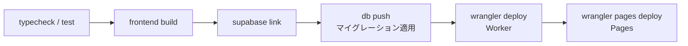

# staging 環境の構築ウォークスルー

2026-10-22 に staging(dev 環境)を初めて構築し、`deploy-staging` を最後まで通したときの流れをまとめたものです。各コマンドの背景や細かい注意点は [`supabase-deployment.md`](./supabase-deployment.md)(以下「手順書」)にあり、このドキュメントは**どの順に何をすればよいか**を一本道で追えるようにしています。production を構築するときも、`staging` を `production` に読み替えれば同じ順で進められます。

## 全体像

デプロイは GitHub Actions(`deploy-staging.yml` → `deploy.yml`)が次の順に行います。



ワークフロー自体は機密値を配布しません。各値は、**それを読む主体のところへ一度だけ手で登録**します。

| 値 | 読む主体 | 登録先 | 手順 |
| --- | --- | --- | --- |
| `SUPABASE_ACCESS_TOKEN` / `SUPABASE_PROJECT_ID` / `SUPABASE_DB_PASSWORD` | CI(`supabase link` / `db push`) | GitHub Environment `staging` の Secrets | 1 |
| `CLOUDFLARE_API_TOKEN` / `CLOUDFLARE_ACCOUNT_ID` | CI(`wrangler deploy` / `pages deploy`) | GitHub Environment `staging` の Secrets | 2 |
| `SUPABASE_URL` / `SUPABASE_SECRET_KEY` / `SESSION_SECRET` / `MAIL_API_KEY` / `GOOGLE_SHEETS_API_KEY` | Worker(実行時) | `wrangler secret put --env staging` | 3 |
| `TURNSTILE_SECRET_KEY` | Worker(実行時) | `wrangler secret put --env staging` | 4 |
| `BACKEND_URL` / `SESSION_SECRET` / `PUBLIC_TURNSTILE_SITE_KEY` | Pages(実行時) | Pages プロジェクトの Production 環境の変数 | 6 |

`SUPABASE_URL` / `SUPABASE_SECRET_KEY` を GitHub の Secrets に入れても Worker には届きません(ワークフローが参照しないため)。今回は最初にそこへ登録してしまい、後から Worker 側に入れ直しました。

## 事前に済んでいたこと

- Supabase の staging プロジェクトの作成(手順書 3 章)
- GitHub の `staging` Environment の作成と、`SUPABASE_PROJECT_ID` / `SUPABASE_DB_PASSWORD` の登録

## 手順

### 1. Supabase の Access Token を登録する

1. https://supabase.com/dashboard/account/tokens でトークンを発行する
   - 対象: **staging プロジェクトだけ**
   - 権限: projects = read、database = read-write、API keys(`api_gateway_keys_read`)= read
   - 有効期限を設定する(最長 1 年)
2. `gh secret set SUPABASE_ACCESS_TOKEN --env staging`

権限の詳細は手順書 6.5 にあります。スコープ付きトークンは後から権限を変更できないので、足りなければ作り直します。

### 2. Cloudflare の API トークンとアカウント ID を登録する

1. `My Profile > API Tokens > Create Token > Custom token` で作成する。権限は手順書 6.5 の表のとおり(Workers Scripts / Cloudflare Pages / Queues の Edit など)。値は**作成直後の画面に一度だけ**表示される
2. アカウント ID は Dashboard の `Workers & Pages` の右側に表示されている
3. 登録する
   ```bash
   gh secret set CLOUDFLARE_API_TOKEN --env staging
   gh secret set CLOUDFLARE_ACCOUNT_ID --env staging
   ```
4. 以降の手順のために、ローカルの wrangler にログインしておく: `cd apps/backend && bunx wrangler login`

### 3. Worker のシークレットを登録する

手順 2 の `cd apps/backend` で既に `apps/backend` にいるので、再度移動せずにそのまま続ける。

```bash
openssl rand -base64 32          # SESSION_SECRET 用。手順 6 でも使うので保存しておく

bunx wrangler secret put SUPABASE_URL --env staging
bunx wrangler secret put SUPABASE_SECRET_KEY --env staging
bunx wrangler secret put SESSION_SECRET --env staging
bunx wrangler secret put MAIL_API_KEY --env staging            # 用意できていれば
bunx wrangler secret put GOOGLE_SHEETS_API_KEY --env staging   # 用意できていれば
```

- 最初の 1 回は Worker がまだ無いので、作成するか聞かれる。**Yes** と答える
- 確認: `bunx wrangler secret list --env staging`
- `"vars.TURNSTILE_SECRET_KEY" exists at the top level ... Please add ...` という警告が出るが、想定どおり。**指示どおりに追記してはいけない**(手順書 6.2)

### 4. Turnstile の widget を作る

1. Dashboard の **Turnstile** → **Add widget**
   - Widget name: `regional-quiz-staging`
   - Hostname: `regional-quiz-frontend-staging.pages.dev`(独自ドメインが無い間は Pages の既定ホスト名)
   - Widget Mode: Managed / Pre-clearance: No
2. **Secret Key** を Worker に登録する: `bunx wrangler secret put TURNSTILE_SECRET_KEY --env staging`
3. **Site Key** は手順 6 で使うので控えておく

### 5. 一斉メール用の Queue を作る

```bash
bunx wrangler queues create regional-quiz-bulk-mail-staging --message-retention-period-secs 86400
bunx wrangler queues create regional-quiz-bulk-mail-staging-dlq --message-retention-period-secs 86400
```

Workers Free プランでも作成できますが、保持期間は最大 24 時間です。既定の 4 日のままだと作成に失敗するので、明示的に指定します(手順書 6.2.2)。Queue が無いと `wrangler deploy` が失敗します。

### 6. Pages プロジェクトを作り、変数を登録する

手順 3〜5 では `apps/backend` にいるので、兄弟ディレクトリの `apps/frontend` へ移動する。

```bash
cd ../frontend
bunx wrangler pages project create regional-quiz-frontend-staging --production-branch main
bunx wrangler pages secret put SESSION_SECRET --project-name regional-quiz-frontend-staging
```

- production branch は必ず `main` にする(CI は `--branch main` でアップロードする)
- 作成後の URL が `regional-quiz-frontend-staging.pages.dev` になったか確認する。違う場合は、手順 4 の widget のホスト名を直す
- Dashboard の `Settings > Variables and Secrets` の **Production** 環境に、次の 2 つを登録する
  - `BACKEND_URL` = `https://regional-quiz-backend-staging.<アカウントのサブドメイン>.workers.dev`(末尾の `/` や `/api` は付けない)
  - `PUBLIC_TURNSTILE_SITE_KEY` = 手順 4 の Site Key
- `SESSION_SECRET` は手順 3 と**同じ値**にする。ずれると、ログイン後に `/staff/*` がログイン画面へ戻されてしまう

### 7. dry-run を行い、デプロイする

```bash
# リポジトリのルートで
bunx supabase login
bunx supabase link --project-ref <staging の project ref>
bunx supabase db push --linked --dry-run     # 未適用のマイグレーションが一覧されれば OK

gh workflow run deploy-staging.yml --ref develop
gh run watch <run id> --exit-status
```

ローカルの `link` で、`supabase/.temp/project-ref` が staging を指すようになります。あとで production を手で操作するときは、リンク先を確認してから実行してください(手順書 5 章)。

## つまずいた点

初回デプロイは 3 回目で通りました。

| 回 | 失敗したステップ | エラー | 原因と対処 |
| --- | --- | --- | --- |
| 1 | Link the Supabase project | `Access token not provided` | `SUPABASE_ACCESS_TOKEN` が未登録だった → 手順 1 |
| 2 | Link the Supabase project | `Missing required permission(s): api_gateway_keys_read` | スコープ付きトークンの権限が足りなかった → API keys の read を加えて作り直した |
| 3 | Deploy the frontend to Cloudflare Pages | `Uncaught TypeError: The argument 'path' ... Received 'undefined' at ... createRequire` | 下記 → PR #143 で修正 |

3 回目の失敗は、コード側の不具合が原因でした。

- Vite の SSR ビルドは既定で `node` 条件を使ってパッケージを解決する。そのため `packages/shared` が使う `yaml` が CommonJS 版で取り込まれた
- Rolldown がその `require` を `createRequire(import.meta.url)` に変換し、Pages Functions では `import.meta.url` が `undefined` なので、Function の読み込み時に落ちた
- `ci.yml` は `vite build` を実行しないため、デプロイで初めて表に出た
- `apps/frontend/vite.config.ts` で、本番ビルドのときだけ `workerd` / `worker` 条件で解決するように修正した

修正はマージ前のブランチを `workflow_dispatch` で staging にデプロイして確認しました(`gh workflow run deploy-staging.yml --ref <branch>`)。こうすると、次に `develop` へ push されるまで staging はそのブランチの内容になります。

同じ種類の問題はローカルで再現できます。

```bash
cd apps/frontend
bun run build
bunx wrangler pages dev .svelte-kit/cloudflare --binding BACKEND_URL=http://127.0.0.1:1
```

起動時に `Uncaught TypeError` が出れば、Pages でも落ちます。

## デプロイ後の確認

| 確認内容 | 期待する結果 |
| --- | --- |
| `https://regional-quiz-backend-staging.<サブドメイン>.workers.dev/api/healthz` | `{"ok":true}` |
| `https://regional-quiz-frontend-staging.pages.dev/`、`/staff/login` | 200 |
| `https://regional-quiz-frontend-staging.pages.dev/<存在しない地域>/<存在しない大会>/entry` | 404(500 にならなければ、SSR → Worker → Supabase が疎通している) |
| `https://regional-quiz-frontend-staging.pages.dev/api/healthz` | 404。Worker route が未設定のための想定どおりの挙動(#101) |

## この時点での制限と残作業

- **独自ドメインと Worker の route(#101)**: これが済むまで、ブラウザから直接 `/api/*` を呼ぶ処理(CSV ダウンロード、クライアント側の `createApiClient()`)は 404 になる。メール内のリンクも、仮のドメインの `FRONTEND_URL` のまま
- **メール送信**: `MAIL_API_KEY` の登録と、Resend での送信ドメインの認証が必要。ドメインが決まるまでは送れない
- **`GOOGLE_SHEETS_API_KEY`**: 未登録ならシートの取り込みが失敗する。Google Cloud Console で Sheets API だけに制限したキーを作る
- **後片付け**: 権限が足りなかった古い Supabase トークンの削除と、GitHub の `staging` Environment に残っている使われない `SUPABASE_URL` / `SUPABASE_SECRET_KEY` の削除

## production を構築するときの差分

- Supabase のトークンは **production プロジェクトだけ**に絞って別に発行する
- `SESSION_SECRET` と Turnstile の widget は staging とは別に作る
- Queue の名前は `regional-quiz-bulk-mail` / `regional-quiz-bulk-mail-dlq`、Pages のプロジェクト名は `regional-quiz-frontend`
- `production` Environment に Required reviewers を設定する(手順書 6.5)
- `deploy-production` は適用前に `db push --dry-run` の結果をログに残すので、承認する前に確認する
